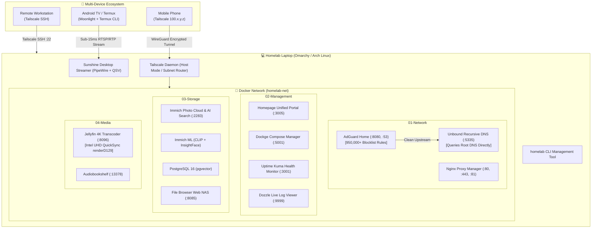

# 🚀 Laptop Homelab & TV Streaming Hub

[](https://docs.docker.com/compose/)
[](https://tailscale.com/)
[](https://jellyfin.org/docs/general/administration/hardware-acceleration/intel/)
[](https://adguard.com/)
[](https://immich.app/)
[](LICENSE)

> **Turn any spare laptop into a modular, zero-trust homelab server featuring local AI photo search, 4K hardware media streaming, recursive privacy ad-blocking, and ultra-low-latency 60 FPS TV casting.**

---

## 📑 Table of Contents
- [Architecture & Network Blueprint](#-architecture--network-blueprint)
- [Key Features](#-key-features)
- [Hardware & Testing Specifications](#-hardware--testing-specifications)
- [Live Service Catalog](#-live-service-catalog)
- [Quick Start Guide](#-quick-start-guide)
- [CLI Controller: `homelab`](#-cli-controller-homelab)
- [Remote Access via Tailscale](#-remote-access-via-tailscale)
- [TV & Termux Remote Streaming](#-tv--termux-remote-streaming)
- [Repository Structure](#-repository-structure)
- [Deep-Dive Documentation](#-deep-dive-documentation)
- [License](#-license)

---

## 🏗️ Architecture & Network Blueprint



---

## ✨ Key Features

* 🌐 **Zero-Trust Remote Access Anywhere:** Built-in Tailscale WireGuard mesh networking. No port forwarding, no DDNS, and no public IP exposure required.
* 🛡️ **Two-Tier Privacy DNS & Ad Sinkhole:** AdGuard Home with **950,000+ domains blocked** (HaGeZi Multi ULTIMATE, OISD Big, Phishing Army, Smart TV telemetry blockers) upstreamed to a recursive **Unbound** resolver querying root internet nameservers directly.
* 📸 **AI Photo Cloud (Google Photos Alternative):** Immich with native facial recognition (InsightFace) and semantic vector search (CLIP) running entirely offline on local hardware.
* 🎬 **4K Hardware Media Server:** Jellyfin with Intel Quick Sync Video (QSV) hardware acceleration mapped via `/dev/dri/renderD129` for sub-5% CPU transcoding.
* 🎮 **Sub-15ms TV Remote Desktop:** Sunshine server utilizing PipeWire DMA-BUF Wayland screen capture streamed to Moonlight on Android TV with PulseAudio network sound redirection.
* 🎛️ **Unified Dashboards:** Live, customizable Homepage dashboard, visual Dockge Compose manager, Dozzle real-time container log streamer, and Uptime Kuma monitoring.
* ⚡ **Zero Host Bloat:** All services are containerized in 6 decoupled stacks. Reverting or migrating the homelab takes a single directory removal.
* 🔋 **Headless Laptop Automation:** Dedicated lid-switch control allowing the laptop to run coolly with the lid closed as an unattended server.

---

## 💻 Hardware & Testing Specifications

This homelab is tested and optimized on budget/mid-range laptop hardware:

| Component | Hardware Specification |
| :--- | :--- |
| **Host System** | Intel Core i5-1035G1 (4 Cores / 8 Threads, up to 3.60 GHz) |
| **GPU / Transcoding**| Intel Iris Plus Graphics G1 / UHD Graphics (`i915`, QSV VA-API) |
| **Memory** | 16 GB DDR4 RAM |
| **Primary OS Storage**| 256 GB NVMe SSD (btrfs / ext4) — Houses OS and all container DBs |
| **Bulk Storage** | 1 TB Secondary Drive (NTFS / ext4) mounted under `/mnt/storage` |
| **Operating System** | Omarchy Linux (Arch Linux base, Hyprland/Wayland, Linux Kernel 6.13+) |

---

## 📦 Live Service Catalog

| Service | Port | Category | Primary Function |
| :--- | :--- | :--- | :--- |
| **[Homepage](https://gethomepage.dev/)** | `:3005` | Management | Unified dashboard with system metrics and live bookmarks |
| **[Dockge](https://dockge.kuma.pet/)** | `:5001` | Management | Visual Docker Compose stack editor and container manager |
| **[Immich](https://immich.app/)** | `:2283` | Storage | Self-hosted photo/video backup with facial recognition and AI search |
| **[Jellyfin](https://jellyfin.org/)** | `:8096` | Media | 4K media server with Intel QuickSync hardware transcoding |
| **[File Browser](https://filebrowser.org/)** | `:8085` | Storage | Lightweight personal web cloud drive for bulk storage |
| **[AdGuard Home](https://adguard.com/)** | `:8080`, `:53` | Network | Network-wide ad, tracker, and malware DNS sinkhole |
| **[Unbound](https://nlnetlabs.nl/projects/unbound/)** | `:5335` | Network | Validating recursive DNS resolver querying root servers directly |
| **[Sunshine](https://app.lizardbyte.dev/Sunshine/)** | `:47990` | Streaming | Ultra-low latency desktop/game streaming to TV & mobile |
| **[Audiobookshelf](https://www.audiobookshelf.org/)**| `:13378`| Media | Dedicated audiobook and podcast streaming server |
| **[Uptime Kuma](https://github.com/louislam/uptime-kuma)** | `:3001` | Monitoring | Real-time service uptime, latency monitoring, and alerting |
| **[Dozzle](https://dozzle.dev/)** | `:9999` | Monitoring | Lightweight, zero-config real-time Docker container log viewer |
| **[Nginx Proxy Manager](https://nginxproxymanager.com/)** | `:81` | Network | Reverse proxy with automated Let's Encrypt SSL certificates |

---

## ⚡ Quick Start Guide

### 1. Clone the Repository
```bash
git clone https://github.com/your-username/homelab-laptop.git ~/Projects/homeLabs
cd ~/Projects/homeLabs
```

### 2. Configure Environment Variables
Copy the template configuration and customize your paths, passwords, and Tailscale IP:
```bash
cp .env.example .env
nano .env
```

### 3. Install the Management CLI
```bash
mkdir -p ~/.local/bin
cp homelab ~/.local/bin/homelab
chmod +x ~/.local/bin/homelab
```

### 4. Deploy All Stacks
Start all services in dependency order with one command:
```bash
homelab start
```

### 5. Check System Health
```bash
homelab status
```

---

## 🎮 CLI Controller: `homelab`

The included `homelab` CLI gives you unified terminal control over all services:

```text
Homelab Management CLI
Usage: homelab [command]

Commands:
  status     Show live health, Tailscale peers, and service URLs (default)
  start      Start all homelab Docker stacks in order
  stop       Gracefully stop all homelab Docker stacks
  restart    Restart all homelab Docker stacks
  logs [svc] View live streaming logs for any container (e.g. homelab logs immich_server)
  pull       Pull latest container images across all stacks
  help       Show this help message
```

---

## 🌐 Remote Access via Tailscale

No public ports need to be forwarded on your home router. Tailscale establishes an encrypted peer-to-peer WireGuard mesh between all your devices:

1. **Start the Tailscale container:** Tailscale will output an authentication link on first start:
   ```bash
   docker logs tailscale
   ```
2. **Authorize the machine:** Click the link in your browser to attach `homelab-laptop` to your Tailnet.
3. **Access Services Anywhere:** From your phone or remote laptop connected to Tailscale, access your services using the static Tailscale IP:
   * **Dashboard:** `http://100.82.40.45:3005`
   * **Immich Mobile App:** Server URL `http://100.82.40.45:2283`
   * **Terminal SSH:** `ssh ghostblaster@100.82.40.45`

*Detailed setup instructions: [docs/remote-access-tailscale.md](docs/remote-access-tailscale.md)*

---

## 📺 TV & Termux Remote Streaming

Stream your laptop screen, emulators, and media to an Android TV / Google TV at 60 FPS sub-15ms latency:

### 1. 60 FPS Desktop & Game Streaming (Sunshine + Moonlight)
1. Install **Moonlight** on your Android TV from the Play Store or sideload it.
2. Pair Moonlight with Sunshine on your laptop via `https://<laptop-ip>:47990`.
3. Launch Moonlight from Termux via ADB intent:
   ```bash
   ./tv-tools.sh moonlight
   ```

### 2. Stream Laptop Audio to TV Soundbar
Stream lossless audio over the local network using PulseAudio's TCP protocol:
```bash
TV_IP="192.168.1.150" ./tv-tools.sh audio-sink
```

*Comprehensive TV guide: [docs/termux-android-tv-bible.md](docs/termux-android-tv-bible.md)*

---

## 📂 Repository Structure

```text
.
├── .env.example                  # Fully annotated environment variable template
├── .gitignore                    # Security-focused ignore rules (keeps secrets safe)
├── LICENSE                       # MIT License
├── README.md                     # Master project documentation
├── homelab                       # CLI management controller script
├── install-and-run.sh            # One-step automated deployment script
├── toggle-lid-mode.sh            # Headless laptop lid behavior switcher
├── tv-tools.sh                   # Android TV & Termux automation utility
│
├── stacks/                       # Modular Docker Compose Stacks
│   ├── 01-network/               # AdGuard Home, Unbound, NPM, Tailscale
│   ├── 02-management/            # Homepage, Dockge, Uptime Kuma, Dozzle
│   ├── 03-storage/               # Immich (Web, ML, pgvector, Redis), File Browser
│   ├── 04-media/                 # Jellyfin (QSV HW Transcoding), Audiobookshelf
│   ├── 05-automation/            # Home Assistant, Mosquitto MQTT (Optional)
│   └── 06-servarr/               # Gluetun VPN, qBittorrent, *arr stack (Optional)
│
└── docs/                         # In-Depth Theoretical & Technical Guides
    ├── architecture.md           # System blueprint, storage tiering, and hardware offloading
    ├── homelab-networking-deep-dive.md # 100KB+ networking bible (OSI, DNS, WireGuard, Kernel)
    ├── termux-android-tv-bible.md# Complete Android TV & Termux hacking & streaming guide
    ├── remote-access-tailscale.md# Zero-trust remote mesh networking setup
    ├── adguard-unbound-setup.md  # 950k+ blocklist DNS sinkhole architecture
    ├── troubleshooting.md        # Real-world operational runbook & debugging guide
    └── master-plan.md            # Original homelab design specification
```

---

## 📚 Deep-Dive Documentation

* 📖 **[Homelab Networking Deep Dive (100KB)](docs/homelab-networking-deep-dive.md):** Comprehensive theoretical and practical guide covering OSI layers, DNS recursion, Docker veth routing, WireGuard protocol, and Linux kernel internals.
* 📺 **[The Termux Android TV Bible](docs/termux-android-tv-bible.md):** Complete guide to turning an Android TV into a streaming receiver, remote node, and automation target.
* 🏗️ **[System Architecture](docs/architecture.md):** Hardware acceleration details, POSIX file locking constraints, and storage layout.
* 🛡️ **[AdGuard + Unbound DNS Setup](docs/adguard-unbound-setup.md):** Mega-blocklist deployment and recursive root resolver configuration.
* 🌐 **[Zero-Trust Remote Access](docs/remote-access-tailscale.md):** Tailscale overlay mesh networking and DNS override.
* 🛠️ **[Troubleshooting Runbook](docs/troubleshooting.md):** Step-by-step solutions for UFW firewall forwarding, Wi-Fi IP changes, and systemd conflicts.

---

## 📄 License

This project is open-source and licensed under the [MIT License](LICENSE).
