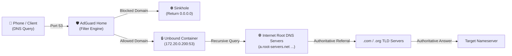

# 🛡️ Privacy DNS Architecture: AdGuard Home + Recursive Unbound

This document describes the two-tiered DNS architecture implemented in this homelab: combining **AdGuard Home** (as an ad-blocking and filtering sinkhole) with **Unbound** (as a local, validating, recursive DNS resolver querying internet root servers directly).

---

## 1. Architectural Overview

Standard home DNS setups send queries to third-party public resolvers (Google `8.8.8.8` or Cloudflare `1.1.1.1`), which can log your browsing history and map client IP addresses. 

This homelab eliminates upstream third-party resolvers:



1. **AdGuard Home (Port 53):** Receives the query from LAN or Tailscale. Checks the domain against 12 blocklists (~955,000+ rules).
   - If blocked: Instantly returns `0.0.0.0` (zero latency, ad request dropped).
   - If clean: Forwards the request to Unbound at `172.20.0.200:53`.
2. **Unbound (172.20.0.200:53):** Performs full recursive DNS resolution directly with the internet's 13 root server clusters. Validates DNSSEC signatures to prevent DNS spoofing, caches the response, and returns the verified IP to AdGuard.

---

## 2. Active Blocklist Catalog (955,000+ Active Rules)

The blocklists configured in [`AdGuardHome.yaml`](file:///home/ghostblaster/Projects/homeLabs/appdata/adguard/conf/AdGuardHome.yaml) provide comprehensive ad, tracker, telemetry, and malware defense:

| Filter List | Rules | Primary Function |
| :--- | :--- | :--- |
| **HaGeZi Multi ULTIMATE** | ~231,000 | Comprehensive ad, tracker, telemetry, scam, and spyware blocker |
| **OISD Big** | ~244,000 | Mobile in-app ad, telemetry, and tracking blocklist |
| **AdGuard DNS Filter** | ~178,000 | Official AdGuard base filter |
| **Phishing Army** | ~143,000 | Real-time verified phishing and credential-stealing domain list |
| **StevenBlack Unified** | ~72,000 | Unified adware, malware, and fake domain hosts list |
| **AdGuard Annoyances** | ~57,000 | Blocks cookie consent banners, push alerts, and modal popups |
| **AdGuard URL & Tracking** | ~16,000 | Strips tracking tokens and telemetry beacons from URLs |
| **Dan Pollock Hosts** | ~13,000 | Curated list of known advertising and tracking servers |
| **Dandelion Sprout TV** | Verified | Blocks telemetry and promotional ads on Smart TVs & consoles |
| **Windows Spy Blocker** | Verified | Blocks Windows OS telemetry, diagnostics, and data collection |

---

## 3. Unbound DNS Configuration

Unbound is deployed via Docker Compose with a static IP (`172.20.0.200`) on the custom `homelab-net` bridge.

### Unbound Optimization Highlights:
* **Root Anchor Validation (`DNSSEC`):** Enforces cryptographic validation of all DNS responses.
* **Prefetching (`prefetch: yes`):** Frequently queried domain records are refreshed before cache expiration.
* **Hardened Privacy (`hide-identity: yes`, `hide-version: yes`):** Strips server metadata from DNS responses.
* **Aggressive Caching:** Large RRset and message cache slabs reduce external queries by over 80%.

---

## 4. Testing & Verification

You can verify that ad blocking and recursive resolution are functioning from any terminal:

```bash
# 1. Test clean resolution (Resolves via Unbound):
python3 -c '
import socket
s = socket.socket(socket.AF_INET, socket.SOCK_DGRAM)
# Query google.com against 100.82.40.45
packet = b"\x12\x34\x01\x00\x00\x01\x00\x00\x00\x00\x00\x00\x06google\x03com\x00\x00\x01\x00\x01"
s.sendto(packet, ("100.82.40.45", 53))
data, _ = s.recvfrom(512)
print("Resolved IP:", ".".join(str(b) for b in data[-4:]))
'

# 2. Test ad domain blocking (Should return 0.0.0.0):
python3 -c '
import socket
s = socket.socket(socket.AF_INET, socket.SOCK_DGRAM)
# Query pagead2.googlesyndication.com against 100.82.40.45
packet = b"\x12\x34\x01\x00\x00\x01\x00\x00\x00\x00\x00\x00\x07pagead2\x11googlesyndication\x03com\x00\x00\x01\x00\x01"
s.sendto(packet, ("100.82.40.45", 53))
data, _ = s.recvfrom(512)
print("Ad domain sinkholed to:", ".".join(str(b) for b in data[-4:]))
'
```
