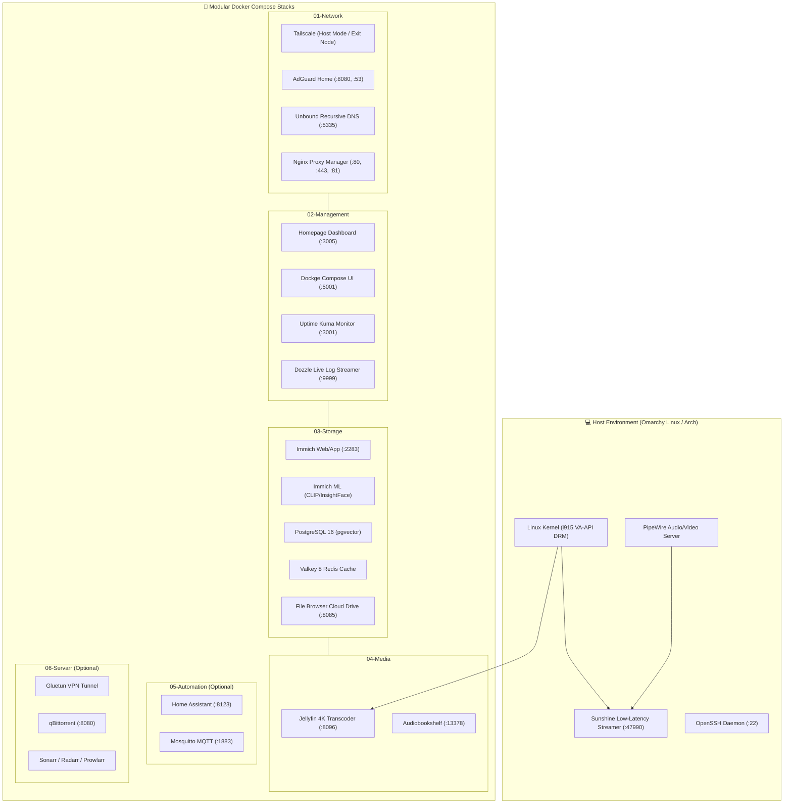

# 🏗️ Homelab Architecture & System Blueprint

This document details the multi-tiered architecture, container topology, storage hierarchy, and hardware offloading capabilities of this modular laptop homelab.

---

## 1. System Topology & Stack Layout

The homelab is partitioned into 6 decoupled, modular Docker Compose stacks connected by an isolated Docker bridge network (`homelab-net`):



---

## 2. Storage Tiering & Filesystem Architecture

To balance high-speed database operations with large-capacity media storage without triggering file-locking issues, the homelab employs a tiered storage layout:

```text
/
├── home/ghostblaster/Projects/homeLabs/
│   ├── appdata/                 # Tier 1: Fast NVMe SSD (btrfs/ext4)
│   │   ├── immich/postgres/     # PostgreSQL pgvector transactional data
│   │   ├── dockge/              # Dockge SQLite database (WAL mode)
│   │   ├── uptime-kuma/         # Uptime Kuma time-series database
│   │   ├── filebrowser/database # BoltDB user metadata
│   │   └── jellyfin/cache/      # Transcoding scratch directory
│   └── stacks/                  # Version-controlled Docker Compose definitions
│
└── mnt/storage/                 # Tier 2: Bulk Secondary Drive (1TB NTFS/ext4)
    ├── media/                   # Jellyfin & Audiobookshelf libraries
    │   ├── movies/
    │   ├── tv/
    │   ├── audiobooks/
    │   └── podcasts/
    ├── photos/                  # Immich original photo and video vault
    ├── downloads/               # Bulk downloads
    └── backups/                 # Container state and volume archives
```

> [!IMPORTANT]
> **Why Database Files Must Never Live on NTFS:**
> SQLite's Write-Ahead Log (`WAL`) and PostgreSQL's lock manager require native POSIX advisory file locking (`fcntl()`). Storing active database volumes on NTFS partitions mounted via `ntfs-3g` causes database corruption or persistent file lock timeouts. All database folders reside strictly in Tier 1 (`appdata/` on NVMe).

---

## 3. Hardware Acceleration & Intel QuickSync (QSV)

The host machine utilizes an **Intel Core i5-1035G1** processor featuring **Intel Iris Plus / UHD Graphics**.

Jellyfin and Sunshine tap directly into the silicon video processing engine:
* **Host Device Nodes:** `/dev/dri/renderD128` or `/dev/dri/renderD129`
* **Driver Stack:** Linux `i915` kernel driver ➔ userspace `libva` / `va-api` ➔ Intel Media Driver (`iHD`)
* **Codec Capabilities:**
  - H.264 (AVC): 8-bit hardware encode and decode
  - H.265 (HEVC): 8-bit and 10-bit hardware encode and decode
  - VP9: 8-bit and 10-bit profile 0/2 hardware decode
* **Docker Passthrough:**
  ```yaml
  devices:
    - /dev/dri/renderD129:/dev/dri/renderD129
  group_add:
    - "video"
    - "render"
  ```
This enables real-time 4K-to-1080p video transcoding on Jellyfin with sub-5% CPU utilization.
