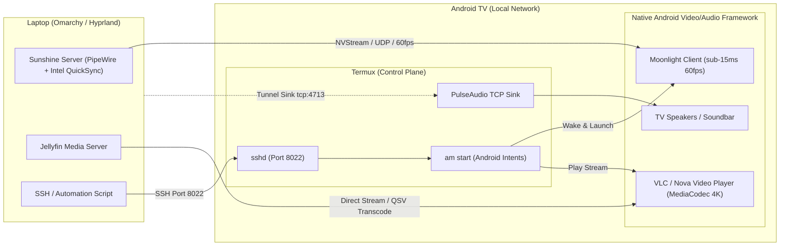
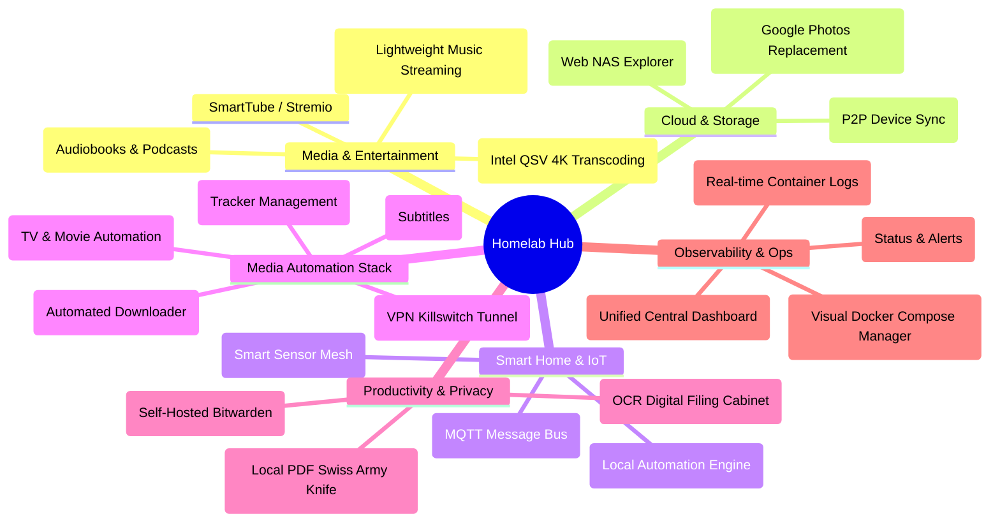

# Master Blueprint: Laptop Homelab & Android TV Termux Integration

## System Profile & Discovered Hardware Specs
- **Host Device:** Laptop running **Omarchy Linux** (Arch rolling kernel 7.2)
- **Desktop Environment:** **Hyprland** (Wayland) with **PipeWire** audio
- **CPU:** Intel Core i5-1035G1 (4 Cores / 8 Threads, Ice Lake)
- **Memory:** 16 GB Physical RAM + 15.4 GB zram compressed swap
- **Graphics / Transcoding:**
  - Primary: **Intel Iris Plus G1** (`/dev/dri/renderD129`) with **Intel Quick Sync Video (QSV)** (supports H.264, HEVC 8/10-bit, VP9 hardware encode/decode)
  - Secondary: NVIDIA GeForce MX230 (`/dev/dri/renderD128`, GP108 architecture — **no NVENC hardware video encoder**)
- **Storage Tiering:**
  - Fast Tier: **238 GB NVMe SSD** (POSIX ext4/btrfs, ~193 GB available)
  - Bulk Tier: **1 TB Secondary Drive** (`/mnt/storage`, NTFS3, ~437 GB available)
- **Network Interfaces:** Gigabit Ethernet (`enp2s0`) + Wi-Fi (`wlp3s0`, `192.168.1.96`)
- **Target Display / TV:** Smart TV running Android TV with **Termux** installed

---

## 1. Can You Cast to Your TV if it Has Termux?

### The Core Answer: **YES, and having Termux gives you superpowers.**

Because your TV runs Termux, it is an **Android TV / Google TV** device. Termux provides an unprivileged Linux userspace on the TV with direct access to Android's OS command line (`am`, `pm`, `input`, `adb`).



### The 4 Modalities to Stream / Cast to the TV (Ranked)

#### 🥇 Rank 1: The Gold Standard — Sunshine (Laptop) $\longrightarrow$ Moonlight (TV)
* **What it does:** Mirrors your entire Hyprland desktop (or any selected app/game) to the TV at **60 FPS or 120 FPS in 4K/1080p with sub-15ms latency** and full audio.
* **Why it beats Chromecast/Miracast:** Standard casting has a 1.5–2.0 second buffer lag, making typing or moving a mouse impossible. Moonlight is an interactive game-streaming protocol.
* **How to automate via Termux:** You install Moonlight once from Google Play Store / F-Droid on the TV. You can launch and pair it directly from your laptop via Termux:
  ```bash
  ssh -p 8022 tv_ip "am start -n com.limelight/com.limelight.ShortcutTrampoline"
  ```

#### 🥈 Rank 2: Media Casting On-Demand (Android Intents to VLC)
* **What it does:** Plays high-bitrate movies, web videos, or YouTube on the TV without desktop mirroring.
* **How Termux handles it:** Run a simple web server on your laptop and send an intent to Android TV's native VLC/ExoPlayer:
  ```bash
  # Tell TV to open stream using native hardware acceleration
  ssh -p 8022 tv_ip "am start -a android.intent.action.VIEW -d 'http://192.168.1.96:8080/movie.mp4' -t 'video/*' -n org.videolan.vlc/.gui.video.VideoPlayerActivity"
  ```

#### 🥉 Rank 3: Wireless Laptop Soundbar (PulseAudio TCP Sink)
* **What it does:** Routes all system audio (Spotify, videos, notifications) from your Linux laptop to your TV speakers over Wi-Fi.
* **Setup:**
  1. On TV Termux:
     ```bash
     pkg install pulseaudio
     pulseaudio --start --exit-idle-time=-1 --load="module-native-protocol-tcp auth-ip-acl=127.0.0.1;192.168.1.0/24 auth-anonymous=1"
     ```
  2. On Laptop (running PipeWire):
     ```bash
     pactl load-module module-tunnel-sink server=tcp:tv_ip:4713 sink_name=tv_soundbar
     ```

#### 🏅 Rank 4: Headless TV Automation (Virtual Remote Control via ADB)
* Enable *Wireless Debugging* in TV Developer Options.
* Inside TV Termux: `pkg install android-tools && adb connect localhost:5555`.
* Now, from your laptop SSH, you can simulate any TV remote button:
  ```bash
  ssh -p 8022 tv_ip "adb shell input keyevent 19" # D-pad Up
  ssh -p 8022 tv_ip "adb shell input keyevent 20" # D-pad Down
  ssh -p 8022 tv_ip "adb shell input keyevent 66" # Enter / Select
  ssh -p 8022 tv_ip "adb shell input keyevent 24" # Volume Up
  ```

> [!WARNING]
> **Avoid pure CLI `mpv` inside Termux for video playback.** TV ARM chipsets lack hardware acceleration inside the Termux terminal sandbox. Software rendering will drop 80% of frames. Always delegate video rendering to native Android apps (`Moonlight`, `VLC`, `Jellyfin TV`) via Termux intents!

---

## 2. "The Full Cloud Storage" & Remote Desktop Solutions

### Cloud Storage: The Golden Duo
* **Avoid Nextcloud AIO:** Nextcloud consumes **2.5 – 4.5 GB RAM** and has heavy maintenance overhead. On a 16 GB machine sharing resources with Jellyfin and Home Assistant, Nextcloud is unnecessary bloat.
* **Immich (Photos & Videos):** The premier open-source Google Photos replacement. Mobile auto-backup, instant timeline scrubbing, facial recognition, and local AI semantic search.
* **File Browser (Files & Documents):** Ultra-lightweight (35 MB RAM) single-binary web file manager. Provides instant web access and public download links for your 1 TB drive.
* *(Optional)* **Syncthing:** For continuous, peer-to-peer 2-way folder sync between laptop, desktop, and phone without intermediary cloud servers.

### Remote Desktop Decision Matrix (Hyprland / Wayland)
| Access From | Recommended Solution | Rationale |
| :--- | :--- | :--- |
| **Smart TV / Android TV** | **Moonlight** (connecting to **Sunshine** on host) | Hardware-accelerated 60fps streaming via Intel QuickSync; low latency. |
| **Phone (Android / iOS)** | **Moonlight** (or **RustDesk**) | Moonlight for smooth video/desktop control; RustDesk for quick administrative tasks. |
| **Public / Work PC Browser** | **Apache Guacamole** (via host `wayvnc`) | Pure HTML5 in any browser tab without installing client apps. |
| **Remote Off-Site Emergency** | **RustDesk** | NAT-punching remote desktop that works without VPN. |

---

## 3. Network Management: AdGuard Home + Tailscale

### Why AdGuard Home Beats Pi-hole in Docker
1. **Single Container:** Pi-hole requires multi-container or web/FTL workarounds; AdGuard is a single clean binary.
2. **Native Encrypted Upstream DNS:** Built-in out-of-the-box support for DNS-over-HTTPS (DoH), DNS-over-TLS (DoT), and DNS-over-QUIC (DoQ) to Cloudflare/Quad9.
3. **Per-Client Rules:** Easily apply strict ad-blocking and YouTube parental filters to your TV, while keeping developer tools unfiltered on your laptop.

### Zero-Port-Forwarding Remote Access via Tailscale
* Turn the laptop into a **Tailscale Subnet Router** (`--advertise-routes=192.168.1.0/24`).
* Connect your phone and TV to your Tailnet. You can securely access Immich, Jellyfin, and your laptop desktop from anywhere in the world without exposing any ports on your home router.

---

## 4. "What All Can I Do?": Comprehensive Capability Catalog



---

## 5. Critical Hardware Rules for This Laptop

1. **GPU Transcode Rule: Intel QuickSync Only!**
   - Target `/dev/dri/renderD129` in Jellyfin and Sunshine.
   - Do **NOT** use the NVIDIA GeForce MX230 (`renderD128`) for encoding—it is based on the GP108 chip which physically lacks an NVENC encoder.
2. **Storage Tiering (NVMe vs NTFS):**
   - **NVMe (`/home/ghostblaster/homelab/appdata`):** Store all Docker databases (Postgres, Redis, SQLite). Placing database files on NTFS causes data corruption due to missing POSIX locks.
   - **1 TB Drive (`/mnt/storage`):** Store bulk media (movies, TV, audiobooks, raw photo uploads, torrent downloads).
3. **Laptop Lid & Power Settings:**
   - Configure systemd to prevent the laptop from suspending when the lid is closed:
     ```bash
     sudo mkdir -p /etc/systemd/logind.conf.d/
     echo -e "[Login]\nHandleLidSwitch=ignore\nHandleLidSwitchDocked=ignore\nHandleLidSwitchExternalPower=ignore" | sudo tee /etc/systemd/logind.conf.d/lid.conf
     sudo systemctl restart systemd-logind
     ```
   - *Battery Care:* If your laptop BIOS supports battery charge limits (or via Omarchy/systemd), cap maximum charge to 60–80% to prevent battery swelling when plugged in 24/7.
4. **Networking:**
   - Whenever possible, connect the laptop to your home router using an Ethernet cable via `enp2s0` for gigabit throughput and zero-jitter streaming.
