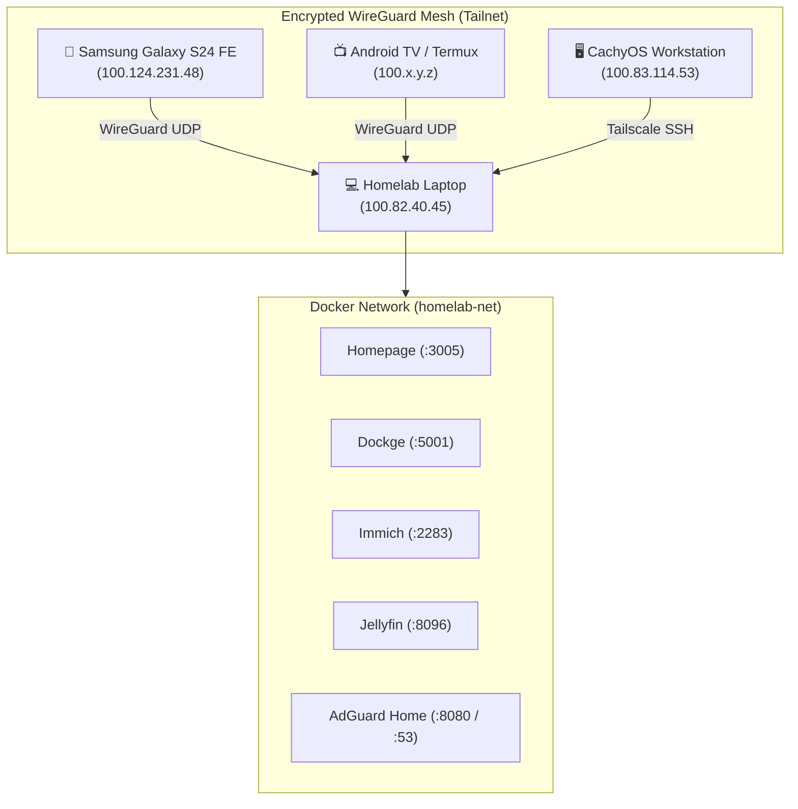

# 🌐 Zero-Trust Remote Access Architecture: Tailscale Integration

This document details how Tailscale is integrated into this homelab, enabling end-to-end encrypted remote access from any device without exposing open ports to the public internet.

---

## 1. Why Tailscale Over Traditional Port Forwarding?

In a standard home server setup, accessing services from outside requires opening ports (80, 443, 22) on your home router and configuring Dynamic DNS (DDNS). This introduces significant security and networking challenges:

1. **Carrier-Grade NAT (CGNAT):** Most cellular connections and modern home ISPs assign private WAN IPs (`100.64.0.0/10`), making port forwarding impossible without a reverse tunnel or VPS.
2. **Public Attack Surface:** Any open port is instantly scanned by botnets and exposed to zero-day vulnerabilities.
3. **Dynamic IP Changes:** Laptops frequently switch between Wi-Fi networks and hotspots, breaking static routing.

Tailscale solves all three by building an overlay **WireGuard mesh network**:



---

## 2. Docker Container Deployment

Tailscale runs directly inside Docker with `network_mode: host` and `cap_add: [NET_ADMIN, NET_RAW]`. This avoids installing system packages while allowing the container to create the host `tailscale0` virtual network adapter:

```yaml
tailscale:
  image: tailscale/tailscale:latest
  container_name: tailscale
  hostname: homelab-laptop
  restart: unless-stopped
  network_mode: host
  cap_add:
    - NET_ADMIN
    - NET_RAW
  volumes:
    - ${APPDATA_PATH}/tailscale:/var/lib/tailscale
    - /dev/net/tun:/dev/net/tun
  environment:
    - TS_STATE_DIR=/var/lib/tailscale
    - TS_USERSPACE=false
    - TS_ROUTES=192.168.1.0/24
    - TS_EXTRA_ARGS=--advertise-exit-node
```

### Key Parameters:
* **`network_mode: host`**: Connects the container directly to the host's network namespace, allowing all Docker-mapped ports to be reached via the Tailscale IP.
* **`TS_ROUTES=192.168.1.0/24`**: Advertises your local home subnet so remote devices can reach other LAN hardware.
* **`TS_EXTRA_ARGS=--advertise-exit-node`**: Allows the laptop to act as a secure encrypted VPN exit node when browsing on public Wi-Fi.

---

## 3. Remote Service Access URLs

All services are accessible anywhere globally via your laptop's Tailscale IP (`100.82.40.45`):

| Service | Tailscale URL | Purpose |
| :--- | :--- | :--- |
| **Homepage** | `http://100.82.40.45:3005` | Unified homelab dashboard |
| **Dockge** | `http://100.82.40.45:5001` | Visual Docker Compose editor & manager |
| **Immich** | `http://100.82.40.45:2283` | AI photo cloud & mobile auto-backup |
| **Jellyfin** | `http://100.82.40.45:8096` | 4K media server with hardware transcoding |
| **File Browser** | `http://100.82.40.45:8085` | Cloud file explorer for bulk storage |
| **AdGuard Home**| `http://100.82.40.45:8080` | Ad-blocking control dashboard |
| **Sunshine** | `https://100.82.40.45:47990` | Low-latency 60 FPS desktop streaming |
| **Uptime Kuma** | `http://100.82.40.45:3001` | Service health & latency monitoring |

---

## 4. Global Ad-Blocking via Tailscale DNS

By pairing AdGuard Home with Tailscale, you can block ads on your mobile phone across all networks (both cellular data and Wi-Fi):

1. Open the [Tailscale DNS Console](https://login.tailscale.com/admin/dns).
2. Under **Nameservers**, click **Add Nameserver** ➔ **Custom**.
3. Enter your laptop's Tailscale IP: `100.82.40.45`.
4. Enable the toggle for **Override local DNS**.
5. Disconnect and reconnect Tailscale on your mobile device.

Every DNS query from your phone will now route through AdGuard Home on your laptop and resolve recursively through Unbound.

---

## 5. Tailscale SSH Access

Because your laptop is on the Tailnet, you can securely access its terminal without opening port 22 to the internet:

```bash
# Connect from any authenticated device on your Tailnet
ssh ghostblaster@100.82.40.45
```
