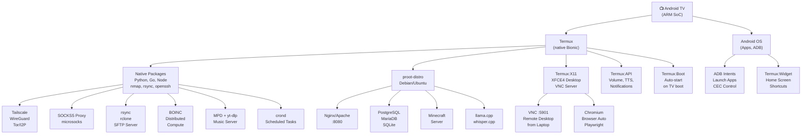

# Termux on Android TV / Google TV — The Complete Homelab Bible

> [!NOTE]
> This covers everything **beyond** Moonlight/Sunshine, PulseAudio sink, and basic ADB. All techniques assume a **non-rooted** Android TV unless noted. Install Termux from **F-Droid** (not Play Store — Play Store version is deprecated and lacks features). All companion add-ons (Termux:API, Termux:Boot, Termux:Widget, Termux:X11) must come from the same source to avoid signature mismatches.

---

## 🔧 One-Time Setup (Do This First)

```bash
# Update everything
pkg update && pkg upgrade -y

# Grant storage access
termux-setup-storage

# Kill the Phantom Process Killer (Android 12/13 — run via ADB from your laptop)
adb shell "/system/bin/device_config set_sync_disabled_for_tests persistent"
adb shell "/system/bin/device_config put activity_manager max_phantom_processes 2147483647"
adb shell "settings put global settings_enable_monitor_phantom_procs false"
# Android 14+: Settings → Developer Options → "Disable child process restrictions" (toggle)

# Disable battery optimization for Termux via ADB
adb shell "dumpsys deviceidle whitelist +com.termux"
```

> [!IMPORTANT]
> The Phantom Process Killer (Android 12+) is the #1 reason scripts die silently. Fix this before doing anything else. Without it, proot, VNC, cron, and SSH servers will randomly die with `[Process completed (signal 9)]`.

---

## 1. Termux as a Full Linux Server

### 1.1 proot-distro — Full Debian/Ubuntu Root Filesystem

**Status: Works Well ✅**

`proot` is not a real container — it intercepts syscalls to fake root. I/O is up to 10× slower. CPU-bound tasks run near-natively. No kernel module loading, no real `/dev` access, no systemd (use process substitution instead).

```bash
pkg install proot-distro -y

# Install Debian (smallest, most server-like)
proot-distro install debian

# Log in (appears as root inside)
proot-distro login debian

# Inside Debian — install anything apt knows about
apt update && apt upgrade -y
apt install curl wget git vim nano build-essential -y
```

**What this unlocks:**
- Full `glibc` environment (vs Termux's Bionic libc) — many pre-built binaries that won't run natively in Termux now work
- Standard Linux FHS paths (`/etc`, `/usr`, `/var`) — config files for nginx, PostgreSQL etc. live where they expect
- `apt` access to the full Debian repo — tens of thousands of packages
- Proper `locale` and `timezone` support

**Gotchas:**
- Ports <1024 are blocked by Android even inside proot (use 8080, 8443, 5432 etc.)
- No `systemd` — start services manually or with a shell wrapper
- Bind mounts inside proot are limited — `-b` flag works but `/proc` and `/dev` are partially faked
- Performance degrades under heavy I/O (database writes, compilation)

---

### 1.2 Nginx / Apache Web Server

**Status: Works Well ✅**

```bash
# Inside proot-distro debian:
apt install nginx -y

# Edit config to use non-privileged port
sed -i 's/listen 80/listen 8080/g' /etc/nginx/sites-available/default
sed -i 's/listen \[::\]:80/listen [::]:8080/g' /etc/nginx/sites-available/default

# Start (no systemd — run directly)
nginx

# Stop
nginx -s stop
```

For Apache:
```bash
apt install apache2 -y
# Edit /etc/apache2/ports.conf → change 80 to 8080
# Edit /etc/apache2/sites-available/000-default.conf → <VirtualHost *:8080>
apachectl start
```

**Result:** Your TV is a real web server at `http://<tv-ip>:8080`. Accessible from any device on your LAN. Good for: personal dashboards, Gitea, Nextcloud lite, static sites.

**Gotcha:** If you run this 24/7, disable Android TV's sleep/display-off timeout from settings or use `termux-wake-lock`. Android may suspend network interfaces when screen is off on some OEM firmwares.

---

### 1.3 Docker Inside proot-Termux

**Status: Not Possible Without Root ❌ (with a workaround ⚠️)**

Docker requires kernel namespaces (`CONFIG_NAMESPACES`, `CONFIG_USER_NS`, `CONFIG_CGROUPS`, `CONFIG_OVERLAY_FS`) that most Android TV kernels don't expose to userspace apps without root. `proot` is NOT a container runtime — it cannot host Docker.

**What actually works (without root):**
```bash
# Rootless Podman — sometimes works if the kernel has userns enabled
# Check first:
cat /proc/sys/kernel/unprivileged_userns_clone  # needs to return 1

# If your kernel supports it (rare on TV boxes):
pkg install podman  # if in Termux repo, else build from source
```

**Realistic alternative — QEMU VM:**
```bash
pkg install qemu-system-x86_64-headless
# Run a real Alpine Linux VM with its own kernel that supports namespaces
# Docker runs fine inside the VM (but double overhead: QEMU + Docker)
```

**Honest verdict:** Don't try Docker on Android TV without root. Use proot-distro for the "I need a Linux environment" use case. Use your homelab server for real containers and SSH in from the TV.

---

### 1.4 SQLite / PostgreSQL / MariaDB

**Status: SQLite Works Great ✅ | PostgreSQL/MariaDB Work with Effort ⚠️**

```bash
# SQLite — native Termux (no proot needed)
pkg install sqlite
sqlite3 ~/mydb.db
# -> .tables, CREATE TABLE ..., etc.

# PostgreSQL — inside proot debian
apt install postgresql -y
# Init the cluster manually (no systemd)
su postgres -c "initdb -D /var/lib/postgresql/data"
su postgres -c "pg_ctl start -D /var/lib/postgresql/data -l /var/log/postgresql/pg.log"
# Connect
psql -U postgres

# MariaDB — inside proot debian
apt install mariadb-server -y
mysql_install_db --user=mysql --basedir=/usr --datadir=/var/lib/mysql
mysqld_safe --user=mysql &
mysql -u root
```

**Gotchas:**
- PostgreSQL default port 5432 is fine (above 1024) — accessible from your LAN if you edit `pg_hba.conf`
- MariaDB port 3306 is fine too
- Both need the data directory initialized before first start (no `systemctl start`)
- Performance is decent for light workloads — don't run analytics on this

---

## 2. TV as a Compute Node

### 2.1 Python / Node.js / Go

**Status: Works Natively ✅**

```bash
# Python (native Termux — very well supported)
pkg install python
python3 --version  # Python 3.12+
pip install requests flask fastapi uvicorn numpy

# Node.js
pkg install nodejs
node --version  # LTS version

# Go
pkg install golang
go version  # Full compiler, not cross-compile wrapper

# Run a FastAPI server from Termux — TV as a microservice endpoint
pip install fastapi uvicorn
uvicorn myapp:app --host 0.0.0.0 --port 8000 --reload
```

**Use cases:** Personal bots, home automation endpoints, webhook receivers, scheduled scrapers. The TV stays plugged in — treat it as a always-on low-power compute node.

---

### 2.2 ML Inference — llama.cpp, whisper.cpp, ONNX Runtime

**Status: Works (with caveats) ⚠️**

```bash
# llama.cpp — the main event
pkg install git cmake clang
git clone https://github.com/ggerganov/llama.cpp
cd llama.cpp
cmake -B build -DCMAKE_BUILD_TYPE=Release
cmake --build build --config Release -j$(nproc)

# Download a small GGUF model (e.g., Phi-3 Mini Q4)
# ~2.3GB — fits in 4GB RAM box
wget https://huggingface.co/microsoft/Phi-3-mini-4k-instruct-gguf/resolve/main/Phi-3-mini-4k-instruct-q4.gguf

# Run inference
./build/bin/llama-cli \
  -m Phi-3-mini-4k-instruct-q4.gguf \
  -t 4 \          # match your SoC's big cores (usually 4)
  -c 2048 \       # context window
  -p "Explain HDMI-CEC in simple terms:"
```

**Expected performance on a mid-range Android TV SoC (e.g. Amlogic S905X4, MT9602):**
- ~2–5 tokens/sec for a 3B Q4 model
- ~0.5–1 token/sec for a 7B Q4 model (borderline usable)
- 1B models run interactively

**whisper.cpp — offline speech-to-text:**
```bash
git clone https://github.com/ggerganov/whisper.cpp
cd whisper.cpp && make -j$(nproc)
bash ./models/download-ggml-model.sh base.en  # ~142MB
./main -m models/ggml-base.en.bin -f audio.wav
# Transcribes a 1min clip in ~30-90 sec on TV hardware
```

**ONNX Runtime:**
```bash
pip install onnxruntime  # CPU-only build for ARM
# Run any .onnx model — good for image classification, NLP tasks
```

**Brutal honest assessment:**
- 1B–3B models: genuinely useful for local AI assistant, summarization, classification
- 7B models: slow but possible — usable for batch processing overnight
- Thermal throttling is real — the SoC will throttle after 10–15 min of sustained inference
- No GPU acceleration in Termux without root + custom Mesa drivers (Turnip for Adreno)
- The TV **will** get warm — ensure ventilation

---

### 2.3 Distributed Computing — BOINC, Folding@home, Tor Relay

**Status: BOINC Works ✅ | Tor Client ✅ | Tor Relay ⚠️ (discouraged)**

```bash
# BOINC client
pkg install boinc boinctui

# Create work directory and join a project
mkdir -p ~/boinc && cd ~/boinc
boinc --dir ~/boinc &
boinccmd --host localhost --create_account https://boinc.berkeley.edu/seti/ \
         your@email.com yourpassword
# Use boinctui for a TUI interface

# Tor client (route TV traffic through Tor)
pkg install tor
# Edit ~/.termux/etc/tor/torrc
echo "SocksPort 9050" >> $PREFIX/etc/tor/torrc
tor &
# Now use: curl --socks5 127.0.0.1:9050 https://check.torproject.org
```

**Tor relay/bridge — discouraged on TV hardware:**
- ISPs may complain about exit relay traffic
- TV boxes lack stable uptime guarantees
- Run as a bridge (not exit) if you insist:
```bash
# In torrc:
BridgeRelay 1
ORPort 9001
ExitPolicy reject *:*  # no exit traffic
Nickname MyTVBridge
```

---

### 2.4 SSH Tunneling — TV as Jump Host / SOCKS5 Proxy

**Status: Works Very Well ✅**

```bash
# On TV — start SSH server (always do this via Termux:Boot)
pkg install openssh
sshd  # listens on port 8022

# On laptop — use TV as SOCKS5 proxy for all traffic
ssh -D 1080 -N -f -p 8022 user@<tv-ip>
# Configure browser/system to use SOCKS5 proxy: 127.0.0.1:1080

# Use TV as a jump host to reach another device on TV's LAN
ssh -J user@<tv-ip>:8022 user@192.168.1.100

# Persistent tunnel with autossh (keeps reconnecting)
pkg install autossh
autossh -M 0 -D 1080 -N -p 8022 user@<tv-ip>

# Reverse tunnel — expose laptop port through TV (TV must have static IP or Tailscale)
ssh -p 8022 -R 2222:localhost:22 user@<tv-ip>
# Now from TV: ssh localhost -p 2222 → reaches your laptop

# ~/.ssh/config on laptop for convenience:
# Host tv
#     HostName 192.168.1.50
#     Port 8022
#     User u0_a123
#     IdentityFile ~/.ssh/id_ed25519
```

**Generate SSH key in Termux:**
```bash
ssh-keygen -t ed25519 -C "tv-termux"
# Add public key to laptop's ~/.ssh/authorized_keys for passwordless auth
```

---

## 3. TV Automation & Control

### 3.1 Termux:API on Android TV — What Actually Works

Install: `pkg install termux-api` + install Termux:API APK (F-Droid)

| API Command | Works on TV? | Notes |
|---|---|---|
| `termux-volume` | ✅ Yes | Controls all Android audio streams — very useful |
| `termux-notification` | ✅ Yes | Pops Android notification — depends on launcher visibility |
| `termux-tts-speak "text"` | ✅ Yes | Uses Android TTS engine — great for alerts |
| `termux-wifi-connectioninfo` | ✅ Yes | Returns SSID, BSSID, RSSI |
| `termux-battery-status` | ❌ Usually No | TVs are mains-powered, returns dummy values |
| `termux-brightness` | ❌ Usually No | TV firmware manages backlight directly |
| `termux-sensor -l` | ⚠️ Partial | Most TVs have no accelerometer/gyro, may have temp sensor |
| `termux-wake-lock` | ✅ Yes | **Critical** — prevents Android from sleeping Termux |
| `termux-microphone-record` | ⚠️ Depends | Only if TV has a mic (most don't) |
| `termux-camera-photo` | ❌ Rarely | Almost no Android TVs have cameras |
| `termux-clipboard-get/set` | ✅ Yes | Works — useful for script automation |
| `termux-speech-to-text` | ⚠️ Depends | Needs mic hardware |
| `termux-torch` | ❌ No | No flashlight on TVs |
| `termux-vibrate` | ❌ No | No vibration motor on TVs |

**Volume control from script:**
```bash
# Set media volume to 50%
termux-volume media 50

# Get current volume levels
termux-volume

# Mute
termux-volume music 0
```

**Scripted voice alert:**
```bash
# Announce server status
termux-tts-speak "Backup completed at $(date +%H:%M)"
```

---

### 3.2 Automating TV Wake/Sleep

**Status: Works via ADB commands ✅**

From Termux itself (loopback ADB to localhost):
```bash
# Install ADB in Termux
pkg install android-tools

# Connect to local ADB (needs USB debugging enabled + ADB over network)
adb connect 127.0.0.1:5555

# Wake display
adb shell input keyevent KEYCODE_WAKEUP

# Sleep display
adb shell input keyevent KEYCODE_POWER

# Check screen state
adb shell dumpsys power | grep mWakefulness
```

**HDMI-CEC Sleep/Wake — from Termux → TV → connected devices:**
```bash
# Check if your TV box exposes CEC sysfs (Amlogic-based boxes often do)
ls /sys/class/cec/

# If present, send CEC standby broadcast (0xFF = all devices)
echo "0xff 0x36" > /sys/class/cec/cmd  # Standby all
echo "0x40 0x04" > /sys/class/cec/cmd  # One Touch Play (wake TV + set active source)
```

> [!WARNING]
> `/sys/class/cec/` access requires root on most devices. Without root, use ADB keyevents instead, which triggers the TV OS's own CEC handling.

**Scheduled wake using cron:**
```bash
# Wake TV every day at 8 AM for a morning dashboard
0 8 * * * DISPLAY=:0 adb shell input keyevent KEYCODE_WAKEUP
```

---

### 3.3 Scheduled Tasks — cron inside Termux

**Status: Works Well ✅**

```bash
pkg install cronie termux-services
# Restart Termux session to activate services
sv-enable crond
sv up crond

# Edit crontab
crontab -e

# Example crontab entries:
# Daily apt upgrade of proot debian at 3 AM
0 3 * * * proot-distro login debian -- apt update -qq && apt upgrade -y -qq

# Every 15 min: sync files to NAS
*/15 * * * * rsync -az ~/projects/ user@nas.local:/backups/tv/

# Every morning at 7:30 — speak weather
30 7 * * * termux-tts-speak "Good morning. Temperature is $(curl -s wttr.in/?format=1)"

# Restart SSH server on reboot (redundant to Termux:Boot but belt-and-suspenders)
@reboot sshd
```

---

### 3.4 Termux:Boot — Auto-Start on TV Boot

**Status: Works Well ✅**

```bash
# Install Termux:Boot APK from F-Droid
# Open it once to grant boot permission
# Create boot scripts
mkdir -p ~/.termux/boot/

# 1_wakelock.sh — must be first
cat > ~/.termux/boot/1_wakelock.sh << 'EOF'
#!/data/data/com.termux/files/usr/bin/bash
termux-wake-lock
EOF

# 2_ssh.sh
cat > ~/.termux/boot/2_ssh.sh << 'EOF'
#!/data/data/com.termux/files/usr/bin/bash
sshd
EOF

# 3_services.sh — start cron, databases, etc.
cat > ~/.termux/boot/3_services.sh << 'EOF'
#!/data/data/com.termux/files/usr/bin/bash
sv up crond
# Start proot services
proot-distro login debian -- bash -c "nginx; pg_ctl start -D /var/lib/postgresql/data"
EOF

chmod +x ~/.termux/boot/*.sh
```

---

### 3.5 Termux:Widget — Scripts from Home Screen

**Status: Works ⚠️ (Android TV launchers vary)**

```bash
# Install Termux:Widget APK from F-Droid
mkdir -p ~/.shortcuts/

# Create launchable scripts
cat > ~/.shortcuts/restart_ssh.sh << 'EOF'
#!/data/data/com.termux/files/usr/bin/bash
pkill sshd; sshd
termux-notification -t "SSH" --content "Server restarted"
EOF

cat > ~/.shortcuts/sync_nas.sh << 'EOF'
#!/data/data/com.termux/files/usr/bin/bash
rsync -az ~/projects/ user@nas.local:/backups/tv/ && \
termux-tts-speak "Sync complete"
EOF

chmod +x ~/.shortcuts/*.sh
```

> [!NOTE]
> Android TV launchers (Google TV, stock AOSP TV) may not support widget placement like a phone launcher does. You may need to launch scripts through a shortcut app or via Tasker integration instead.

---

## 4. TV as a Network Node

### 4.1 Tailscale on the TV

**Status: Works Very Well ✅ (official app) | Works ⚠️ (Termux CLI)**

**Recommended: Install the official Tailscale APK on Android TV**
```bash
# From your laptop — set Always-On VPN via ADB
adb shell settings put secure always_on_vpn_app com.tailscale.ipn
adb shell settings put secure always_on_vpn_lockdown 0
```

**Termux CLI (if you need Tailscale inside a script/proot):**
```bash
# Community-maintained Termux Tailscale CLI
curl -fsSL https://raw.githubusercontent.com/bropines/tailscale-termux-cli/main/remote-install.sh | bash
tailscale up --authkey=<your-auth-key>
tailscale status
```

**The power of this:** Once the TV is on Tailscale, you can:
- SSH into Termux from anywhere in the world: `ssh -p 8022 user@<tv-tailscale-ip>`
- Access the TV's web server from the road: `http://<tv-tailscale-ip>:8080`
- Use the TV as a Tailscale exit node (good for "I need my home IP")

---

### 4.2 WireGuard Peer in Termux

**Status: Requires Root for kernel mode ❌ | Userspace WG works ✅**

```bash
# Userspace WireGuard (no root needed)
pkg install wireguard-tools

# Create WG config
mkdir -p ~/.wireguard
cat > ~/.wireguard/wg0.conf << 'EOF'
[Interface]
PrivateKey = <your-private-key>
Address = 10.0.0.2/24
DNS = 1.1.1.1

[Peer]
PublicKey = <server-public-key>
Endpoint = vpn.yourdomain.com:51820
AllowedIPs = 0.0.0.0/0
PersistentKeepalive = 25
EOF

# Connect (userspace mode — no root)
wg-quick up ~/.wireguard/wg0.conf
```

> [!NOTE]
> Without root, WireGuard must use the userspace Go implementation (`wireguard-go`), which is available in Termux. Performance is lower than kernel WireGuard but fully functional.

---

### 4.3 Tor Node / I2P Node

```bash
# Tor client
pkg install tor
tor &
# SOCKS5 proxy at 127.0.0.1:9050

# i2pd (C++ I2P — lighter than Java i2p)
pkg install i2pd
i2pd --daemon
# HTTP proxy at 127.0.0.1:4444, SOCKS5 at 127.0.0.1:4447
# Console UI at http://127.0.0.1:7070

# Java I2P (heavier, ~256MB RAM)
pkg install openjdk-17
# Download i2pinstall jar from geti2p.net
java -jar i2pinstall_*.jar -console
~/i2p/i2prouter start
```

---

### 4.4 Network Scanner (nmap)

**Status: Works Well ✅**

```bash
pkg install nmap

# Discover all devices on home LAN
nmap -sn 192.168.1.0/24

# Scan a specific device for open ports
nmap -sV -p 1-65535 192.168.1.1

# OS detection (may need ADB connect for raw socket access)
nmap -O 192.168.1.1

# Quick scan of common ports
nmap --top-ports 100 192.168.1.0/24
```

> [!NOTE]
> Some scan types (SYN stealth `-sS`) require raw socket access and may fail without root. TCP connect scans (`-sT`) work fine without root.

---

### 4.5 SOCKS5 / HTTP Proxy — TV as Proxy Exit Node

**Status: Works Well ✅**

```bash
# microsocks — tiny SOCKS5 proxy
pkg install microsocks
microsocks -p 1080 -u myuser -P mypassword &
# Other devices on LAN configure SOCKS5: <tv-ip>:1080

# 3proxy — full-featured HTTP + SOCKS5
# Build from source inside proot debian:
apt install build-essential git
git clone https://github.com/z3APA3A/3proxy
cd 3proxy && make -f Makefile.Linux
# Configure /etc/3proxy.cfg

# SSH-based SOCKS5 from laptop through TV
# (Detailed above in 2.4)
```

---

## 5. TV Display & UI Hacks

### 5.1 Termux:X11 — Full Desktop on TV

**Status: Works Well ✅ (best X11 experience on Android)**

```bash
# Install Termux:X11 APK from GitHub releases
pkg install x11-repo
pkg install termux-x11-nightly xfce4 xfce4-goodies

# Launch X11 + XFCE on TV display
termux-x11 :0 &
export DISPLAY=:0
startxfce4 &

# Open the Termux:X11 app on TV — you'll see the XFCE desktop on screen

# Performance tip: disable compositor in XFCE
# Window Manager Tweaks → Compositor → uncheck "Enable display compositing"
```

**Inside proot debian for better app support:**
```bash
proot-distro login debian -- bash -c "
  export DISPLAY=:0
  startxfce4
"
```

**What you can run on the desktop:**
- Firefox/Chromium (in Termux x11-repo)
- LibreOffice (proot debian)
- GIMP, Inkscape (proot debian)
- VS Code (proot debian — `code --no-sandbox`)
- Any X11 app

**Resolution/scaling:**
In the Termux:X11 app settings, set resolution to match your TV (1920×1080 or 3840×2160).

---

### 5.2 VNC Server — Remote Desktop from Laptop

**Status: Works Well ✅**

```bash
pkg install x11-repo
pkg install tigervnc xfce4

# First time setup
vncserver  # sets password, creates ~/.vnc/
vncserver -kill :1

# Configure startup
cat > ~/.vnc/xstartup << 'EOF'
#!/data/data/com.termux/files/usr/bin/sh
xfce4-session &
EOF
chmod +x ~/.vnc/xstartup

# Start VNC (display :1 = port 5901)
vncserver -geometry 1920x1080 -depth 24

# From your laptop:
# vncviewer <tv-ip>:5901
# Or via SSH tunnel (secure):
# ssh -p 8022 -L 5901:localhost:5901 user@<tv-ip>
# then: vncviewer localhost:5901
```

---

### 5.3 Browser Automation — Playwright / Puppeteer

**Status: Works with Effort ⚠️**

```bash
# Install Chromium (system browser for Termux)
pkg install x11-repo chromium

# Node.js + Puppeteer-core (point at system Chromium)
pkg install nodejs
npm install puppeteer-core

# In your script:
cat > scraper.js << 'EOF'
const puppeteer = require('puppeteer-core');
(async () => {
  const browser = await puppeteer.launch({
    executablePath: '/data/data/com.termux/files/usr/bin/chromium-browser',
    headless: true,
    args: ['--no-sandbox', '--disable-gpu', '--disable-dev-shm-usage', '--no-zygote']
  });
  const page = await browser.newPage();
  await page.goto('https://example.com');
  console.log(await page.title());
  await browser.close();
})();
EOF
node scraper.js

# Python Playwright
pip install playwright
playwright install chromium  # may fail on ARM — use system Chromium instead
```

**Gotchas:** Memory usage is high (~300–500MB per Chrome instance). On a 2GB RAM TV box, one instance may exhaust available RAM. Good for batch/overnight scraping, not concurrent use.

---

### 5.4 Termux:GUI — Native Android UI from Scripts

**Status: Experimental ⚠️ (functional but niche)**

```bash
# Install Termux:GUI APK from F-Droid/GitHub
# Enable "Display over other apps" in Android settings for the plugin
pip install termuxgui

# Python example — create a native Android button dialog
python3 << 'EOF'
import termuxgui as tg
import sys

with tg.Connection() as c:
    a = tg.Activity(c)
    layout = tg.LinearLayout(a)
    btn = tg.Button(a, layout, "Run Backup")
    for event in c.events():
        if event.type == tg.Event.click and event.id == btn.id:
            import subprocess
            subprocess.run(["rsync", "-az", "/sdcard/", "user@nas:/backups/"])
        if event.type == tg.Event.destroy and event.id == a.id:
            sys.exit()
EOF
```

**Use case:** Create a simple control panel that appears as a native Android dialog on your TV — buttons to trigger backups, start/stop services, etc. Good for TV home screen integration without needing a full web UI.

---

### 5.5 ADB Intents from Termux — Launch Any App/Activity

**Status: Works Very Well ✅ (already in your tv-tools.sh)**

```bash
# Already in your setup — extending it:

# Launch YouTube to a specific video
adb shell "am start -a android.intent.action.VIEW \
  -d 'https://www.youtube.com/watch?v=dQw4w9WgXcQ' \
  -n com.google.android.youtube.tv/.TvMainActivity"

# Launch Netflix
adb shell "monkey -p com.netflix.ninja 1"

# Launch Kodi
adb shell "am start -n org.xbmc.kodi/.Splash"

# Open a specific settings page
adb shell "am start -a android.settings.WIFI_SETTINGS"

# Take a screenshot to a file
adb shell screencap /sdcard/screenshot.png && adb pull /sdcard/screenshot.png

# List all installed packages
adb shell pm list packages | grep -v "^package:com.android"

# Send text input to currently focused field
adb shell input text "Hello from Termux"
```

---

## 6. File Sync & Backup

### 6.1 rsync — Sync to NAS / Laptop

**Status: Works Very Well ✅**

```bash
pkg install rsync openssh

# One-way push to NAS
rsync -avz --progress \
  ~/storage/shared/ \
  user@192.168.1.200:/nas/backup/tv/

# Pull from NAS
rsync -avz user@192.168.1.200:/nas/media/ ~/storage/movies/

# Exclude junk
rsync -avz --exclude '*.tmp' --exclude '.DS_Store' \
  ~/storage/ user@nas.local:/backup/

# Passwordless via SSH key (set up once)
ssh-keygen -t ed25519
ssh-copy-id -p 22 user@nas.local
```

---

### 6.2 rclone — Mount NFS/SMB/Cloud as Local Filesystem

**Status: Works Well ✅**

```bash
pkg install rclone fuse-utils

# Configure an SMB NAS share
rclone config
# → n (new), name: nas, type: smb, host: 192.168.1.200, user/pass, save

# Mount the NAS share as local folder
mkdir -p ~/nas
rclone mount nas: ~/nas \
  --vfs-cache-mode full \
  --allow-other \
  --daemon

# Now ~/nas/ looks like a local folder!
ls ~/nas/

# Sync TV photos to Google Drive
rclone sync ~/storage/shared/DCIM/ gdrive:TV-Backup/

# Unmount
fusermount -u ~/nas
```

> [!NOTE]
> Standard `mount.smb` / `mount.nfs` kernel mounts **require root**. `rclone mount` is the non-root alternative using FUSE — fully functional but slightly higher CPU overhead.

---

### 6.3 Termux as SFTP Server

**Status: Works Very Well ✅**

```bash
pkg install openssh
passwd  # set a password for the Termux user
sshd    # starts on port 8022

# From laptop — connect via SFTP
sftp -P 8022 user@<tv-ip>

# Or use FileZilla:
# Protocol: SFTP
# Host: <tv-ip>
# Port: 8022
# Username: (Termux user — usually blank)
# Password: (what you set with passwd)

# Files are accessible at ~/storage/ (after termux-setup-storage)
```

**For pure FTP (less secure but simpler for some clients):**
```bash
pkg install pure-ftpd
pure-ftpd -S 2121 &
# Port 2121 (>1024 required)
```

---

## 7. Fun / Esoteric / Creative Uses

### 7.1 Minecraft Server on Your TV

**Status: Works! ⚠️ (expect 10–20 player slots max)**

```bash
# proot debian + Java
proot-distro login debian
apt install openjdk-17-jre-headless wget -y
mkdir -p ~/minecraft && cd ~/minecraft

# Download Paper (lightweight server core)
wget https://api.papermc.io/v2/projects/paper/versions/1.21.1/builds/latest/downloads/paper-1.21.1-latest.jar -O server.jar

# Accept EULA
echo "eula=true" > eula.txt

# Launch (tune memory to your TV's RAM — 1.5–2GB recommended)
java -Xmx1536M -Xms512M \
  -XX:+UseG1GC \
  -jar server.jar nogui
```

**Realistic expectations:**
- 2–5 players: smooth on 3GB+ RAM TV box
- 10+ players: will struggle — consider it a private family server
- World generation is slow on ARM — pre-generate chunks with chunky plugin

---

### 7.2 RetroArch on TV via Termux

**Status: CLI is Theoretical ❌ | Workaround via ADB ✅**

RetroArch has no proper headless CLI mode. The recommended path:
```bash
# Install RetroArch native Android APK (not via Termux)
# Then trigger it from Termux via ADB intents:
adb shell "am start -n com.retroarch/.browser.retroactivity.RetroActivityFuture \
  --es ROM /sdcard/roms/nes/supermario.nes \
  --es LIBRETRO /data/data/com.retroarch/cores/fceumm_libretro_android.so"
```

For actual emulation CLI in Termux, use `mednafen` (native pkg):
```bash
pkg install mednafen
# Emulates NES, SNES, PSX — outputs audio/video to... where? No display without X11
# Use with Termux:X11: DISPLAY=:0 mednafen game.nes
```

---

### 7.3 TV Speaking — TTS Alerts

**Status: Works Perfectly ✅**

```bash
# Basic
termux-tts-speak "Dinner is ready"

# With custom pitch and rate
termux-tts-speak -r 0.8 -p 1.2 "Warning: disk space is critically low"

# Chained with sensors/scripts
FREE_SPACE=$(df -h ~/storage | tail -1 | awk '{print $4}')
termux-tts-speak "Available storage: $FREE_SPACE"

# Cron-triggered morning briefing
cat > ~/scripts/morning.sh << 'EOF'
#!/bin/bash
WEATHER=$(curl -s "wttr.in/?format=%t+%C" 2>/dev/null)
termux-tts-speak "Good morning. The weather is $WEATHER."
EOF
crontab -e
# 0 7 * * 1-5 ~/scripts/morning.sh
```

---

### 7.4 MPD + yt-dlp — YouTube Audio Through TV Speakers

**Status: Works Well ✅**

```bash
pkg install mpd mpc ffmpeg python
pip install yt-dlp

# MPD config
mkdir -p ~/.config/mpd/playlists
cat > ~/.config/mpd/mpd.conf << 'EOF'
music_directory     "~/storage/music"
playlist_directory  "~/.config/mpd/playlists"
db_file             "~/.config/mpd/database"
log_file            "~/.config/mpd/log"
pid_file            "~/.config/mpd/pid"
state_file          "~/.config/mpd/state"

audio_output {
    type            "opensl"
    name            "Android OpenSL Audio"
}

bind_to_address     "0.0.0.0"
port                "6600"
EOF

mpd  # start daemon

# Stream a YouTube URL through the TV speakers
ytplay() {
  URL=$(yt-dlp -g -f bestaudio "$1" 2>/dev/null)
  mpc clear
  mpc add "$URL"
  mpc play
}

ytplay "https://youtube.com/watch?v=VIDEO_ID"

# Control from laptop! Install an MPD client and point to <tv-ip>:6600
# MALP, ncmpcpp, Cantata all work
```

---

### 7.5 Gemini Protocol Server

**Status: Works Well ✅ (great weekend project)**

```bash
# Install Go (Gemini servers are almost all Go or Python)
pkg install golang

# Agate — popular Gemini server in Rust (install via cargo)
pkg install rust
cargo install agate

# Create your Gemini capsule
mkdir -p ~/gemini/content
cat > ~/gemini/content/index.gmi << 'EOF'
# My TV Gemini Capsule

Welcome to my Android TV homelab capsule.

=> about.gmi About This Setup
=> projects.gmi Projects
EOF

# Generate TLS cert (required by Gemini protocol)
openssl req -x509 -newkey rsa:4096 \
  -keyout ~/gemini/key.pem \
  -out ~/gemini/cert.pem \
  -days 365 -nodes \
  -subj "/CN=<tv-ip>"

# Run Agate
agate --content ~/gemini/content \
      --cert ~/gemini/cert.pem \
      --key ~/gemini/key.pem \
      --addr 0.0.0.0:1965

# Access from any Gemini browser (Lagrange, Amfora):
# gemini://<tv-ip>/
```

**Gopher server:**
```bash
# pygopherd in proot debian
apt install python3-pip
pip3 install pygopherd
# Configure and run on port 70... wait, port <1024 blocked
# Use port 7070 instead:
pygopherd --port 7070 ~/gopher/
```

---

## 🗺️ The Big Picture — Architecture Diagram



---

## ⚡ Quick-Reference Command Cheatsheet

```bash
# === ENVIRONMENT ===
proot-distro login debian          # Enter Debian environment
termux-wake-lock                   # Prevent background kill
termux-setup-storage               # Grant storage permissions

# === SSH SERVER ===
sshd                               # Start SSH on :8022
pkill sshd && sshd                 # Restart

# === WEB SERVER (inside proot) ===
nginx                              # Start nginx on :8080
nginx -s stop                      # Stop

# === DATABASE (inside proot) ===
su postgres -c "pg_ctl start -D /var/lib/postgresql/data -l /var/log/pg.log"
mysqld_safe --user=mysql &

# === ML INFERENCE ===
./llama.cpp/build/bin/llama-cli -m model.gguf -t 4 -p "prompt"
./whisper.cpp/main -m models/ggml-base.en.bin -f audio.wav

# === VPN ===
tailscale up                       # Join tailnet (official app)
wg-quick up ~/.wireguard/wg0.conf  # WireGuard userspace

# === NETWORK ===
nmap -sn 192.168.1.0/24           # LAN device discovery
microsocks -p 1080 -u user -P pass # SOCKS5 proxy
ssh -D 1080 -N -p 8022 user@tv    # Dynamic SOCKS through TV

# === FILE SYNC ===
rsync -avz ~/storage/ user@nas:/backup/
rclone mount nas: ~/nas --vfs-cache-mode full --daemon

# === AUTOMATION ===
crontab -e                         # Edit cron jobs
sv up crond                        # Start cron daemon
termux-tts-speak "Alert message"  # Speak on TV
termux-volume media 50             # Set volume to 50%
adb shell input keyevent KEYCODE_WAKEUP  # Wake TV

# === X11 DESKTOP ===
termux-x11 :0 &                    # Start X11 server
DISPLAY=:0 startxfce4 &           # Launch XFCE
vncserver -geometry 1920x1080      # Start VNC on :5901

# === FUN ===
mpd                                # Start music daemon
mpc add "$(yt-dlp -g -f bestaudio URL)" && mpc play
agate --content ~/gemini/ --cert cert.pem --key key.pem --addr 0.0.0.0:1965
```

---

## 🚧 Limitations Summary

| Limitation | Impact | Workaround |
|---|---|---|
| No ports <1024 | All servers need high ports | Use 8080, 8443, 5432, 3306, etc. |
| Phantom Process Killer | Scripts/servers die randomly | ADB fix (see top of doc) |
| proot I/O 5-10× slower | Database/compile performance | Use native Termux pkgs where possible |
| No Docker (no root) | Can't run containers | proot-distro or QEMU VM |
| No systemd | Services don't auto-start | Manual scripts or Termux:Boot |
| No /dev/fb0 access | Can't write directly to framebuffer | Use Termux:X11 |
| No root = no kernel WireGuard | WireGuard is userspace only | wireguard-go (slower but works) |
| No CEC via sysfs (no root) | Can't send raw CEC | ADB keyevents for power control |
| TV has no battery, mic, camera | Most Termux:API hardware cmds fail | Only volume, TTS, notifications |
| Thermal throttling | ML inference slows after 10-15 min | Use cooling stand; run overnight |
| Android may kill on screen-off | Services die when TV sleeps | `termux-wake-lock` + battery unrestricted |

